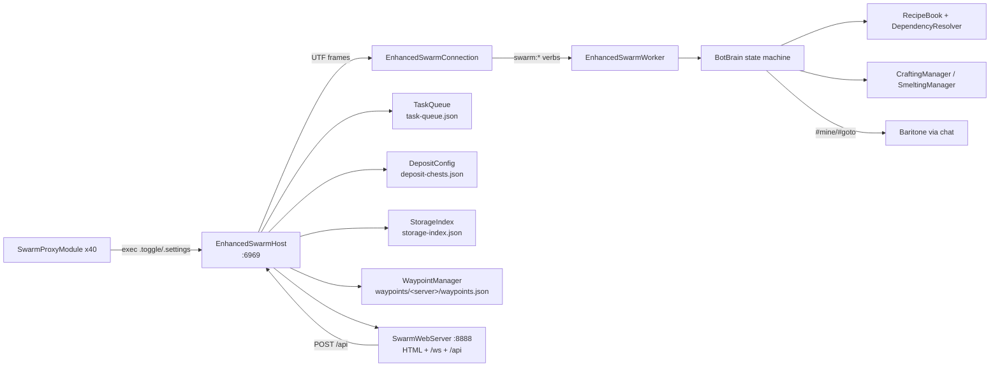

# 16 — Roadmap / Synthesis

## DONE (works today)
- Host/worker TCP swarm on 6969 with reconnect, status, per-worker commands, and a web dashboard on 8888.
- Task queue with persistence, priorities (stored), nicknames, per-bot assignment, `/eswarm` command tree.
- BotBrain autonomous loop for **GATHER → SMELT → CRAFT**, Baritone-driven, with crafting-table prep and staging.
- Tier progression **WOOD → STONE → IRON → DIAMOND** for tools+armor, driven by `RecipeBook` + `DependencyResolver`.
- Deposit economy: categories, per-server chest registry, scan/storage index, withdraw requests, auto-deposit threshold.
- Waypoints (overworld+nether), per-server files, portal push to workers.
- 40 proxy modules for combat/movement, 5 real modules (BotBrain, AirCrystal, PearlChase, Spam, AutoTPA).
- HUD/status/web reporting incl. `tier` per bot.

## PLANNED / MISSING (evidence)
- **Armor to netherite: not implemented.** Enum + inventory check only; no netherite recipe, no smithing table, no
  template handling, no smithing UI state. `resolve(NETHERITE_*)` degenerates into gathering a pickaxe.
- **EQUIP task type**: declared, never scheduled; BotBrain's step switch handles only CRAFT/SMELT/GATHER.
- **SCAN_CHESTS task type**: declared, never scheduled; scans happen via the `scan` verb instead.
- **KIT / TPR / RTP**: zero occurrences. `SwarmAutoTPA` only accepts inbound requests (`/tpy`).
- **Shulkers**: deposit category only; "empty_shulkers" is an alias of "shulkers" (can't distinguish).
- **Death persistence**: `DeathTracker.load()` no-op.
- **Settings sync**: protocol retained, both parsers no-op.
- **Priority dispatch**: comparator exists but dispatch ignores order.
- **Multi-version support**: blocked by hardcoded 1.21.4/1.21.11 mix and absolute mod paths.

## NEXT 5 (ordered)
1. **Fix the build skew + `Connection:47`** — pick 1.21.11 consistently (fabric.mod.json, baritone), repair the `"dY"- "`
   line, remove the absolute MultiMC copy tasks (or guard them behind a property). Nothing else can ship without this.
2. **Add KIT + TPR task types** — `Type.KIT`/`Type.TPR`, worker verbs `kit <name>` / `tpr`, serialized into BotTask; wire
   to BotBrain states that just send chat and wait for inventory/server teleport confirmation.
3. **Netherite chain** — RecipeBook: smithing table, netherite ingot (4 scrap + 4 gold), upgrade recipes; BotBrain
   `SMITHING` state using `SmithingScreenHandler`; resolver special-case for scrap+gold; tier detection from armor slots.
4. **Close the loop on kits** — after TPR, auto-claim kit, sort gear via keep-filter, deposit overflow, then `equip` step
   (implement `Type.EQUIP` with InvUtils armor moves).
5. **Lock down the ports** — bind 127.0.0.1 by default (or configurable bind), add a shared token to the UTF handshake,
   add a token/localhost check to the web panel; fix `swarm:all` broadcast so `/api/command` works for all bots.

## Architecture

## Health summary
13758 lines, 80 files, 44 modules; 5 modules carry real logic; 17 documented bugs/smells (see 14); 1 compile blocker;
2 unauthenticated listeners; 0 tests in the repo.
