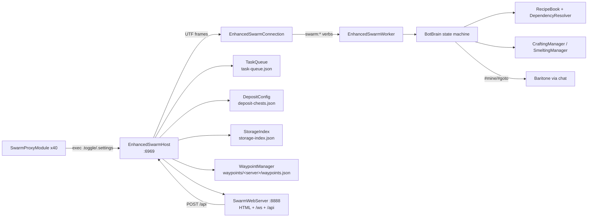

# 16 — Roadmap / Synthesis

## DONE (works today)
- Host/worker TCP swarm on 6969 with reconnect, status, per-worker commands, and a web dashboard on 8888.
- Task queue with persistence, priorities (stored), nicknames, per-bot assignment, `/eswarm` command tree.
- BotBrain autonomous loop for **GATHER → SMELT → CRAFT**, Baritone-driven, with crafting-table prep and staging.
- Tier progression **WOOD → STONE → IRON → DIAMOND** for tools+armor, driven by `RecipeBook` + `DependencyResolver`.
- Deposit economy: categories, per-server chest registry, scan/storage index, withdraw requests, auto-deposit threshold.
- Waypoints (overworld+nether), per-server files, portal push to workers.
- 40 proxy modules for combat/movement, 5 real modules (BotBrain, AirCrystal, PearlChase, Spam, AutoTPA).
- HUD/status/web reporting incl. `tier` per bot.

## PLANNED / MISSING (evidence)
- **Armor to netherite: not implemented.** Enum + inventory check only; no netherite recipe, no smithing table, no
  template handling, no smithing UI state. `resolve(NETHERITE_*)` degenerates into gathering a pickaxe.
- **EQUIP task type**: declared, never scheduled; BotBrain's step switch handles only CRAFT/SMELT/GATHER.
- **SCAN_CHESTS task type**: declared, never scheduled; scans happen via the `scan` verb instead.
- **KIT / TPR / RTP**: zero occurrences. `SwarmAutoTPA` only accepts inbound requests (`/tpy`).
- **Shulkers**: DONE — 26.3 CONTAINER component distinguishes empty from non-empty shulkers.
- **Death persistence**: `DeathTracker.load()` no-op.
- **Settings sync**: protocol retained, both parsers no-op.
- **Priority dispatch**: DONE — pending dispatch is sorted by priority.
- **Multi-version support**: 26.3 port complete; older 1.21.x versions are no longer targeted.

## NEXT 5 (ordered — port-26.3 status)
1. **B — compile green — DONE.** 26.3/Mojang names, Fabric API, JAVA_25 mixins; local build is green.
2. **C — single boot — DONE (build/jar); manual Prism smoke test remains.** Jar metadata verified for Java 25 / MC 26.3.
3. **D — localhost swarm — DONE.** TCP 6969 and web 8888 bind to 127.0.0.1 by default (configurable); web URL is logged.
4. **E — economy — DONE.** Empty/full shulker routing, deposit keep filter, priority dispatch, queue save, and all-bot exec path.
5. **F — lockdown — DONE.** Shared-token handshake, loopback/token web guard, and MMC copy gated behind `-PcopyToMmc`.

## Architecture

## Health summary
13758 lines, 80 files, 44 modules; 5 modules carry real logic; 17 documented bugs/smells (see 14); 0 compile blockers;
2 loopback/token-guarded listeners; 0 tests in the repo.
